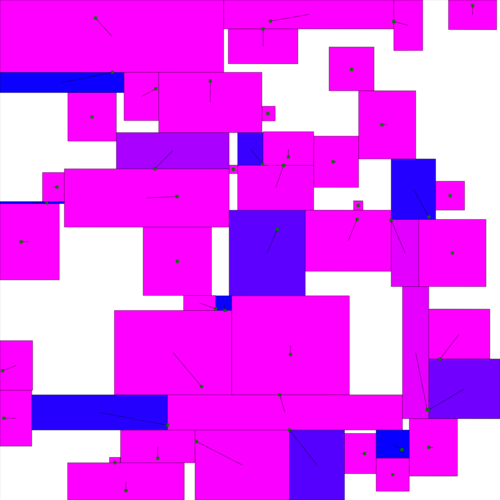

# AtCoder Ad — Ad Placement Optimization

## Problem Description

AtCoder needs to place ads for n companies on their homepage. The ad space is a 10000×10000 square grid.

Each company i wants a rectangular ad space that contains point (x_i+0.5, y_i+0.5) with area as close to r_i as possible. You need to determine placements for all ads to maximize total satisfaction.



## Constraints

- Each ad space must be an axis-aligned rectangle with integer vertex coordinates and positive area
- Different rectangles may share edges but must not overlap (common area must be zero)
- Blank regions are allowed
- 50 ≤ n ≤ 200
- 0 ≤ x_i, y_i ≤ 9999, all (x_i, y_i) are distinct
- r_i ≥ 1 and Σr_i = 10^8

## Scoring Formula

Satisfaction p_i for company i:
- If the ad space does not contain point (x_i+0.5, y_i+0.5), then p_i = 0
- If it contains the point and the ad area is s_i, then p_i = 1 - (1 - min(r_i, s_i) / max(r_i, s_i))²

Final score = round(10^9 × Σp_i / n)

**Goal: maximize the total score.**

## Input Format

Read from standard input:

```
n
x_0 y_0 r_0
x_1 y_1 r_1
...
x_{n-1} y_{n-1} r_{n-1}
```

## Output Format

Write to standard output:

```
a_0 b_0 c_0 d_0
a_1 b_1 c_1 d_1
...
a_{n-1} b_{n-1} c_{n-1} d_{n-1}
```

Where (a_i, b_i) and (c_i, d_i) are opposite corner coordinates of company i's rectangular ad space.
Required: 0 ≤ a_i < c_i ≤ 10000, 0 ≤ b_i < d_i ≤ 10000.

## Resource Limits

| Resource | Limit |
|----------|-------|
| Time limit | 5 seconds / test case |
| Memory limit | 1 GB |
| GPU | Not allowed |

## Programming Language & Build Environment

Recommended: C++17. Compile command: `g++ -std=c++17 -O2`.

The current workspace only guarantees a C++17/g++ build environment. Do not assume `python3`, `cargo`, or `rustc` are installed.

## Evaluation

Evaluation consists of **local testing** and **remote judging**.

### Local Testing (unlimited)

`tools/` provides an input generator and scoring program for free local testing:

```bash
# Generate test input
printf '0\n' > /tmp/seeds.txt
rm -rf /tmp/ad_cases && mkdir -p /tmp/ad_cases
./tools/bin/gen /tmp/seeds.txt -d /tmp/ad_cases
cp /tmp/ad_cases/0000.txt input.txt

# Run your program
./my_solution < input.txt > output.txt

# Local scoring
./tools/bin/tester input.txt output.txt
# stderr output: Score = <score>
```

`tools/bin/gen` reads a seed file and writes generated cases to the output directory. One seed per line; blank lines are ignored. For example, use
`seq 0 9 > /tmp/seeds.txt` then run `./tools/bin/gen /tmp/seeds.txt -d /tmp/ad_cases`
to generate 10 local test cases. See `tools/README.md` for details.

### Remote Judging (limited attempts)

Final scoring is done through the remote judging system. It holds 50 fixed public test cases that you cannot view directly.

After each submission, the system returns:
- Run status for each case (passed / compile error / runtime error / timeout / invalid output)
- Score for each case
- Total score across all 50 cases

**Remote judging has a limited number of attempts** (~100). Use local testing for debugging and reserve remote judging for validating your final solution.

**Final score = sum of scores across all 50 public test cases.**

## Input Generation

- n = round(50 × 4^rand()), where rand() is a uniform random number in [0,1)
- (x_i, y_i) are n distinct coordinates sampled without replacement from {0,...,9999}²
- r_i are generated by sampling n-1 split points without replacement from {1,...,99999999}, ensuring Σr_i = 10^8

n is biased toward smaller values (highest probability near 50, lowest near 200), and r_i values can vary greatly.

## Hints

This is an NP-hard rectangle placement optimization problem. Some potentially useful approaches:

- Greedy strategy: place rectangles one by one in some priority order
- Local search / simulated annealing: neighborhood search from a feasible solution
- Divide and conquer: recursively partition the space and place within sub-regions
- Pay attention to the hard constraint that rectangles must not overlap
- Make extensive use of local tools for testing; submit to remote judging only after finding a robust strategy

## Directory Structure

```
(your working directory)
├── README.md                  # This file
├── solution.cpp               # Initial submittable baseline solution
├── assets/
│   └── visualization.png      # Problem visualization example
└── tools/
    ├── README.md              # Detailed tool usage instructions
    ├── bin/
    │   ├── gen                # Input generator (ready to run)
    │   └── tester             # Scoring program (ready to run)
    └── src/                   # Rust source code (for reference or recompilation)
```
